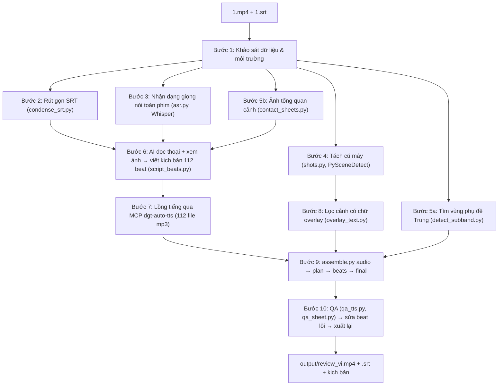
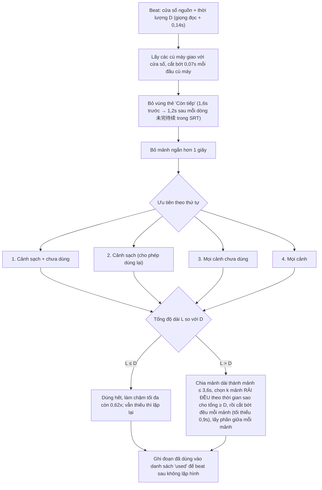

# 🎬 Review Tool – Quy trình biến phim gốc + SRT thành video review tiếng Việt

Tài liệu này mô tả **chi tiết từng bước** quy trình đã dùng để biến:

- **Đầu vào:** `1.mp4` (phim ngắn Trung Quốc, 65 phút, khung dọc 1078×1920, có phụ đề Trung in cứng) + `1.srt` (phụ đề Trung)
- **Đầu ra:** `output/review_vi.mp4` (**20 phút 05 giây**, 1080×1920, lồng tiếng Việt phong cách Người Kể Chuyện, phụ đề Việt in sẵn) + `output/review_vi.srt` + `output/kich_ban_review.txt`

> [!IMPORTANT]
> Quy trình gồm **phần tự động (script Python + ffmpeg)** và **một phần do AI (trợ lý) làm thủ công**: đọc toàn bộ lời thoại, xem ảnh chụp các cảnh, rồi **tự viết kịch bản tiếng Việt** và chọn mốc thời gian hình ảnh cho từng câu. Hiện **chưa có script tự viết kịch bản** – file `pipeline/script_beats.py` là kết quả của bước này. Muốn làm phim khác, cần viết lại file đó (bằng tay hoặc nhờ AI) theo đúng định dạng mô tả ở [Bước 6](#bước-6--viết-kịch-bản-theo-beat-thủ-công--ai).

---

## Mục lục

1. [Tổng quan luồng xử lý](#1-tổng-quan-luồng-xử-lý)
2. [Cấu trúc thư mục](#2-cấu-trúc-thư-mục)
3. [Yêu cầu môi trường](#3-yêu-cầu-môi-trường)
4. [Chi tiết từng bước](#4-chi-tiết-từng-bước)
5. [Nguyên tắc viết kịch bản cuốn hút (Phong cách Người Kể Chuyện)](#5-nguyên-tắc-viết-kịch-bản-cuốn-hút-phong-cách-người-kể-chuyện)
6. [Thuật toán ghép hình khớp lời](#6-thuật-toán-ghép-hình-khớp-lời)
7. [Xử lý hình ảnh, phụ đề, âm thanh](#7-xử-lý-hình-ảnh-phụ-đề-âm-thanh)
8. [Kiểm tra chất lượng (QA)](#8-kiểm-tra-chất-lượng-qa)
9. [Cách sửa và xuất lại video](#9-cách-sửa-và-xuất-lại-video)
10. [Làm với một phim mới](#10-làm-với-một-phim-mới)
11. [Bảng tham số](#11-bảng-tham-số)
12. [Các lỗi đã gặp và cách khắc phục](#12-các-lỗi-đã-gặp-và-cách-khắc-phục)
13. [Cẩm nang tuỳ biến cho mọi thể loại phim (Playbook)](#13-cẩm-nang-tuỳ-biến-cho-mọi-thể-loại-phim-playbook)
14. [Checklist kiểm duyệt 10 điểm & Prompt mẫu tái sử dụng](#14-checklist-kiểm-duyệt-10-điểm--prompt-mẫu-tái-sử-dụng)

---

## 1. Tổng quan luồng xử lý



Ý tưởng cốt lõi: **làm âm thanh trước, cắt hình sau (audio-first)**.
1. Viết kịch bản thành nhiều **beat** (mỗi beat 1–3 câu, 3–15 giây), mỗi beat gắn **cửa sổ thời gian nguồn** (cảnh nào trong phim gốc minh họa cho câu đó).
2. Lồng tiếng từng beat → biết **chính xác mỗi beat dài bao nhiêu giây**.
3. Trong cửa sổ thời gian của beat, chọn các cú máy đẹp, rải đều, tổng thời lượng **khớp đúng** thời lượng giọng đọc.
4. Ghép tất cả lại, phủ phụ đề, trộn âm.

---

## 2. Cấu trúc thư mục

```
review_tool/
├── input/                    # 📥 Bỏ 1 file .mp4 và 1 file .srt của tập mới vào đây
│   ├── 1.mp4                 # Phim gốc (hoặc bất kỳ tên *.mp4 nào trong input/)
│   └── 1.srt                 # Phụ đề Trung gốc (hoặc bất kỳ tên *.srt nào trong input/)
├── README.md                 # Tài liệu này
├── tools/
│   └── ffmpeg.exe            # ffmpeg 9 (từ imageio-ffmpeg) có libass + NVENC
├── pipeline/                 # Toàn bộ code Core
│   ├── condense_srt.py       # B2: rút gọn SRT thành khối thoại có mốc thời gian
│   ├── asr.py                # B3: Whisper large-v3 nhận dạng thoại toàn phim
│   ├── shots.py              # B4: tách cú máy (shot boundary)
│   ├── detect_subband.py     # B5a: thống kê vị trí phụ đề Trung in cứng
│   ├── contact_sheets.py     # B5b: ảnh lưới 6 giây/khung để AI "xem phim"
│   ├── script_beats.py       # B6: KỊCH BẢN tiếng Việt (chia theo beat + cửa sổ thời gian)
│   ├── overlay_text.py       # B8: đánh dấu cú máy có chữ overlay (tên nhân vật, "未完待续")
│   ├── assemble.py           # B9: dựng video (audio / plan / beats / final)
│   ├── qa_tts.py             # B10: chuyển giọng đọc ngược thành chữ để soát lỗi phát âm
│   ├── qa_sheet.py           # B10: ảnh lưới 1 khung/beat từ video thành phẩm
│   └── make_thumbnails.py    # B11: thiết kế 3 mẫu Thumbnail YouTube/Shorts chuẩn UTF-8
├── work/                     # File trung gian (tự tạo khi chạy, có thể xóa sau khi xong)
│   ├── srt_condensed.txt/.json
│   ├── asr.json, asr_gaps.txt
│   ├── shots.json, shot_flags.json, subbands.json, video_meta.json
│   ├── sheets/               # Ảnh lưới tổng quan phim gốc
│   ├── tts/narration.srt     # File nạp vào app TTS
│   ├── tts/narration/        # 1.mp3 … N.mp3 do app TTS sinh ra
│   ├── aud/                  # 001.wav … N.wav (đã cắt khoảng lặng)
│   ├── beats/                # 001.mp4 … N.mp4 (video từng beat) + .sig (cache)
│   ├── band_mask_2d.png      # Mặt nạ 2D viền mềm che vừa khít từng câu sub Trung
│   ├── plan.json             # Kế hoạch cắt hình & tọa độ hộp che sub cho từng beat
│   ├── beats_audio.json
│   ├── joined.mp4            # Ghép các beat
│   ├── narration_full.wav    # Toàn bộ giọng đọc đã căn thời gian
│   ├── subs_vi.ass           # Phụ đề Việt định dạng ASS
│   └── qa/                   # Ảnh QA
└── output/                   # 📤 Tự tạo khi xuất thành phẩm
    ├── review_vi.mp4         # ⭐ VIDEO THÀNH PHẨM
    ├── review_vi.srt         # Phụ đề Việt dạng SRT
    ├── kich_ban_review.txt   # Kịch bản kèm số thứ tự beat
    ├── youtube_seo.txt       # Bộ Tiêu đề, Mô tả, Chapters, Tags chuẩn SEO YouTube
    └── thumbnail_*.jpg       # Bộ 3 Thumbnail (2 ngang 16:9 + 1 dọc 9:16)
```

---

## 3. Yêu cầu môi trường

| Thành phần | Dùng để | Ghi chú |
|---|---|---|
| Windows + PowerShell | Môi trường chạy | |
| Python 3.10 | Chạy pipeline | |
| GPU NVIDIA (RTX 4080) | Whisper (CUDA) + mã hóa video NVENC | Không có GPU vẫn chạy được nhưng phải đổi `h264_nvenc` → `libx264`, Whisper chạy CPU rất chậm |
| `faster-whisper` | Nhận dạng thoại tiếng Trung | Model `large-v3`, `float16` |
| `torch` (cu121) | Cung cấp `cublas64_12.dll` cho faster-whisper | Xem [lỗi 12.1](#121-whisper-báo-thiếu-cublas64_12dll) |
| `scenedetect` 0.7 | Tách cú máy | |
| `opencv-python`, `numpy` | Đọc khung hình, ảnh lưới, phát hiện chữ | |
| `imageio-ffmpeg` | Lấy ffmpeg 9 có sẵn **libass** (in phụ đề) và **NVENC** | Đã copy vào `tools/ffmpeg.exe` |
| App **DgtAutoTTSMM** + MCP `dgt-auto-tts` | Lồng tiếng Việt (MiniMax, giọng clone) | MCP chạy ở `http://localhost:39217/mcp`, giọng `viet_review_dt6Rssa4`, model `speech-02-hd` |
| Font **Roboto Bold** | Phụ đề Việt | Có sẵn trong `C:\Windows\Fonts` |

Cài thư viện Python:

```powershell
pip install faster-whisper scenedetect opencv-python numpy imageio-ffmpeg
# torch bản CUDA (đã có sẵn trên máy): torch==2.5.1+cu121
python -c "import imageio_ffmpeg as i;print(i.get_ffmpeg_exe())"   # copy file này thành tools\ffmpeg.exe
```

---

## 4. Chi tiết từng bước

### Bước 1 – Khảo sát dữ liệu & môi trường

Những gì đã kiểm tra và phát hiện:

| Kiểm tra | Kết quả | Ảnh hưởng tới quy trình |
|---|---|---|
| Thời lượng / độ phân giải | 3907 giây (~65 phút), 1078×1920, 29.97 fps, khung **dọc** | Xuất video dọc 1080×1920 (hợp TikTok / Reels / Shorts / YouTube) |
| Nội dung SRT | Tiếng Trung, 1637 dòng, là phụ đề **OCR** (nhiều lỗi chữ: "男期友", "闺蜜"…) | Không tin 100% vào SRT, cần đối chiếu thêm |
| Khoảng trống trong SRT | Mất hẳn 2 đoạn: **4:25–8:25** và **20:11–30:49** (chỉ còn chữ "未完待续") | Phải nhận dạng giọng nói (Bước 3) để lấp |
| Phụ đề in cứng | Có, chữ trắng viền đen ở khoảng y = 1254–1568 | Phải làm mờ dải đó (Bước 5a) |
| Chữ overlay khác | Thẻ tên nhân vật (徐露露, 周贺川…), chú thích địa điểm, thẻ "未完待续" cuối mỗi tập | Phải tránh các cảnh này (Bước 8) |
| Thể loại | Phim ngắn AI-generated, ghép nhiều tập 1–2 phút, cú máy rất ngắn (1–3 giây) | Nhịp cắt ngắn ~2 giây/cảnh là phù hợp |
| MCP TTS | `get_status` → đăng nhập OK, giọng `viet_review_dt6Rssa4` (Vietnamese); thử đọc 1 câu 25 âm tiết = 5,54 giây | Ước lượng tốc độ đọc ≈ 4,5 âm tiết/giây để tính độ dài kịch bản |

### Bước 2 – Rút gọn SRT (`condense_srt.py`)

```powershell
python pipeline\condense_srt.py
```

- Đọc `1.srt`, gộp các dòng liên tiếp cách nhau ≤ 1,5 giây (và khối ≤ 20 giây) thành **một khối thoại**, định dạng `[h:mm:ss] câu1，câu2，…`.
- 1637 dòng → **257 khối** (~35 KB) → đủ gọn để AI đọc toàn bộ phim trong một lần.
- Xuất `work/srt_condensed.txt` (để đọc) và `work/srt_condensed.json` (danh sách `[start, end, text]`, dùng lại ở Bước 9 để tìm thẻ "未完待续").

### Bước 3 – Nhận dạng giọng nói toàn phim (`asr.py`)

```powershell
python -u pipeline\asr.py
```

- Dùng **faster-whisper large-v3** trên GPU, `language="zh"`, `vad_filter=True`, `beam_size=5`.
- `initial_prompt` chứa tên các nhân vật (沈欣冉, 周贺川, 徐露露, 徐佳佳, 裴既明, 刘美兰) để Whisper viết đúng tên.
- 65 phút xử lý trong **~4,5 phút**, ra 1780 đoạn → `work/asr.json`.
- Trích riêng 2 đoạn bị thiếu trong SRT ra `work/asr_gaps.txt`. Nhờ đó tìm lại được các tình tiết quan trọng mà SRT bỏ sót:
  - Lộ Lộ vay 800 nghìn tệ, Hạ Xuyên đòi lấy 300 nghìn tệ sính lễ, bắt Hân Nhiễm chăm mẹ Lộ Lộ và ông bà nhà họ Chu.
  - Mẹ Lộ Lộ nói *"tôi chỉ còn mỗi đứa con gái này"* → **chi tiết cài cắm** cho cú lật song sinh.
  - Hai bà mẹ ra sân bay chặn, bị tai nạn; toàn bộ màn đối chất ở trung tâm thương mại (phút 20–31).

### Bước 4 – Tách cú máy (`shots.py`)

```powershell
python pipeline\shots.py
```

- PySceneDetect `ContentDetector(threshold=27, min_scene_len=8)`, thu nhỏ khung 6 lần để chạy nhanh.
- Kết quả: **1302 cú máy** → `work/shots.json` (danh sách `[start, end]` giây). Mất ~6,5 phút (CPU).
- Mục đích: khi cắt hình **không bao giờ cắt ngang một cú máy** (tránh dính vài khung hình của cảnh khác), và mỗi đoạn hình được chọn nằm gọn trong một cú máy.

### Bước 5a – Tìm vùng phụ đề Trung in cứng (`detect_subband.py`)

```powershell
python pipeline\detect_subband.py
```

- Lấy ngẫu nhiên 400 khung hình. Với mỗi khung: tìm điểm ảnh **rất trắng (>225)** nằm sát điểm ảnh **rất tối (<50)** → đặc trưng của chữ trắng viền đen.
- Lấy cụm hàng dày đặc nhất làm vị trí phụ đề. Thống kê phân vị:
  - Mép trên: 1254 (2%) … 1481 (98%)
  - Mép dưới: 1341 (2%) … 1568 (98%)
- ⇒ Phụ đề nằm ở 2 vị trí chính (~1254–1343 và ~1424–1513). Dải cần che trong khung gốc: **y ≈ 1235–1590**.

### Bước 5b – Ảnh tổng quan cảnh (`contact_sheets.py`)

```powershell
python pipeline\contact_sheets.py
```

- Cứ **6 giây chụp 1 khung**, ghép lưới 8×4 (32 khung = 192 giây/ảnh), có ghi mốc thời gian vàng ở góc.
- 21 ảnh trong `work/sheets/` bao trọn 65 phút.
- AI xem hết 21 ảnh này để: nhận diện nhân vật (ai là Hân Nhiễm, ai là Lộ Lộ…), biết cảnh nào xảy ra ở phút nào (tai nạn xe 7:31, máy bay 8:13, viện dưỡng lão 34:19, bờ biển 52:37, nghĩa trang 63:19…), và phát hiện chữ overlay.

### Bước 6 – Viết kịch bản theo beat (thủ công / AI)

Đây là bước **quan trọng nhất về chất lượng**, do AI thực hiện bằng cách đọc `srt_condensed.txt` + `asr_gaps.txt` + xem `work/sheets/*.jpg`.

**6.1. Lập "hồ sơ phim" (Story Bible) trước khi viết**

*Bảng nhân vật – dùng tên Hán Việt cố định từ đầu đến cuối:*

| Tên gốc | Tên trong review | Vai trò |
|---|---|---|
| 沈欣冉 | Thẩm Hân Nhiễm | Nữ chính |
| 周贺川 | Chu Hạ Xuyên | Vị hôn phu 10 năm, phản bội |
| 徐露露 | Từ Lộ Lộ | Bạn thân thật, người từng cứu Hân Nhiễm, **đã chết từ lâu** |
| 徐佳佳 | Từ Giai Giai | Em song sinh, **mạo danh Lộ Lộ** |
| 裴既明 | Bùi Ký Minh | Học trò của mẹ Hân Nhiễm, chồng mới |
| 刘美兰 | Lưu Mỹ Lan | Mẹ Hạ Xuyên, chết trong tai nạn |

> Lưu ý giữ bí mật: nửa đầu video vẫn gọi kẻ mạo danh là "Lộ Lộ" (vì nữ chính và khán giả chưa biết), chỉ đổi sang "Giai Giai" sau cảnh lật mặt ở viện dưỡng lão → giữ nguyên cú sốc.

*Chuỗi nhân quả chính (giữ lại / lược bỏ):*
1. Sinh nhật 30 tuổi, 7 ngày trước đám cưới: "bạn thân" mượn vị hôn phu đi nước ngoài 3 năm → Hạ Xuyên đồng ý.
2. Hân Nhiễm cắt lỗ, nhờ mẹ mai mối, quyết định cưới người khác sau 7 ngày.
3. Cặp kia vòi tiền, đòi sính lễ, bắt cô chăm người nhà → cô từ chối.
4. Ngày đính hôn: 2 bà mẹ ra sân bay chặn, **tai nạn** → mẹ Hạ Xuyên chết, mẹ Lộ Lộ cụt 2 chân; cặp kia trên máy bay cho rằng cô bịa chuyện.
5. 2 năm ở nước ngoài → Hạ Xuyên về, tìm Hân Nhiễm khắp nơi → cô đã có chồng con.
6. Đối chất → sự thật về cuộc gọi tai nạn → Hạ Xuyên biết mẹ đã chết.
7. "Lộ Lộ" về thăm mẹ → **mẹ vạch mặt: cô là Giai Giai**, Lộ Lộ thật đã chết khi leo núi.
8. Hân Nhiễm đọc nhật ký Lộ Lộ thật → kiện đòi 200 nghìn tệ.
9. Giai Giai lồng lộn → Hạ Xuyên biết mình đã mang nhầm người đi.
10. Hạ Xuyên hẹn Giai Giai ra biển → **cả hai chết** (camera: Hạ Xuyên ra tay trước).
11. Tòa cưỡng chế nợ → Hân Nhiễm đưa chồng con đi viếng mộ Lộ Lộ thật.

Lược bỏ: các đoạn tóm tắt lặp lại đầu mỗi tập, thoại phụ (nhân viên lễ tân, quán cà phê nói lặp), chi tiết vàng cưới "3 món / 5 món"…

**6.2. Định dạng file `script_beats.py` (Gồm `INTRO_DUB` 30s Mở màn Thoại gốc + `BEATS` Review)**

```python
TITLE = "CHÀNG NHÂN VIÊN QUÈN THỰC CHẤT LÀ TỔNG TÀI TRĂM TỶ"

# Phần 1: ~30 giây Mở màn Lồng tiếng Thoại gốc Cao trào (Tách từng câu ngắn có ngắt nghỉ tự nhiên)
# Mỗi dòng = 1 file voice độc lập (4–15 âm tiết, dài 0.8–2.8s), tuyệt đối KHÔNG gộp thành 1 câu dài ngoằng!
# Định dạng: (block_id, "h:mm:ss.s", sfx_lead_sec, post_pause_sec, "Câu thoại ngắn")
INTRO_DUB = [
    (1, "1:47:24.2", 0.00, 0.22, "Nhìn thấy chưa,"),
    (1, "1:47:24.2", 0.00, 0.25, "đó là bố ruột của tôi,"),
    (1, "1:47:24.2", 0.00, 0.65, "giám khảo chính hôm nay đích thân đến chống lưng cho tôi đấy."),
    (1, "1:47:24.2", 0.00, 0.38, "Lục Trầm, hôm nay mày tiêu đời chắc rồi."),
    (1, "1:47:24.2", 0.00, 0.25, "Tao sẽ cho mày thua không còn mảnh vải che thân."),
    (2, "1:48:00.2", 1.65, 0.42, "Đồ nghiệt tử không biết trời cao đất dày!"),
    (2, "1:48:00.2", 0.00, 0.30, "Mày câm miệng ngay cho tao!"),
    ...
]

# Phần 2: Các Beat Review theo Phong cách Người Kể Chuyện (Ngôi thứ ba)
BEATS = [
    # Beat 1: Nối tiếp ngay sau điểm cắt 30s mở màn (sau 0.55s Freeze Frame chuyển cảnh)
    ("1:49:29-1:49:44", "Chỉ bằng một lời phán quyết lạnh lùng tước đoạt hợp đồng sống còn ngay trên sóng truyền hình..."),
    # Beat 2: Cầu nối đưa mạch truyện quay ngược về đầu phim
    ("0:00:00-0:01:36", "Để hiểu vì sao vị thái tử gia nắm giữ đế chế Hoàn Vũ Lục thị hàng trăm tỷ lại ẩn danh..."),
    ...
]
```

- **Quy tắc `INTRO_DUB` (~30s Mở màn Thoại gốc):**
  - Chọn phân cảnh đấu khẩu / vạch mặt gay cấn nhất phim, cắt bỏ các đoạn thoại phụ rườm rà ở giữa để cô đọng trong `3–5` cụm cảnh gốc liền mạch (`block_id`), tổng thời lượng **28 – 33 giây**.
  - **Tách từng câu ngắt nghỉ thành Voice mới:** Chỗ nào trong `.srt` gốc nhân vật ngắt nghỉ hoặc chuyển câu thì tách thành 1 phần tử riêng trong `INTRO_DUB` (12–16 câu thoại ngắn cho 30s mở màn) để app TTS đọc thành **file voice mới riêng biệt**, chèn khoảng nghỉ `post_pause_sec` (`0.22s – 0.65s`) khớp với khẩu hình và nhịp chuyển góc máy.
  - Tự động kết thúc phần mở màn bằng **0.55 giây khựng hình chuyển cảnh (Freeze Frame + Fade tối dần)** trước khi vào `BEATS`.
- **Quy tắc `BEATS` (Phần thân Review):**
  - **Cửa sổ thời gian** dạng `h:mm:ss-h:mm:ss`, nhiều cửa sổ cách nhau bằng dấu phẩy.
  - Lời bình giữ 100% **ngôi thứ ba (Người Dẫn Chuyện)**, viết **số bằng chữ** ("ba trăm nghìn tệ", "hai năm") để TTS đọc tự nhiên.

**6.3. Cấu trúc kịch bản**

| Phần | Cấu trúc | Nội dung | Thời lượng |
|---|---|---|---|
| Mở màn Thoại gốc (`INTRO_DUB`) | 12–16 câu thoại ngắn | Cắt cảnh cao trào đắt giá nhất phim, lồng tiếng Việt trực tiếp từng câu ngắn có ngắt nghỉ tự nhiên, dừng ở Cliffhanger + `0.55s` Freeze Frame | ~30–33 giây |
| Cầu nối vào Review | Beat 1–2 | Nêu hậu quả tức thì của màn cao trào + lật thân phận nhân vật chính + dẫn ngược về đầu phim | ~25 giây |
| Hồi 1 | Beat 3–24 | Khởi đầu xung đột, biến cố mở màn | |
| Hồi 2–8 | Beat 25–105 | Các nấc thang xung đột, phản kích và lật mở sự thật | |
| Hồi cuối + Kết | Beat 106–120 | Cao trào báo ứng, đại đoàn viên và thông điệp khép lại | |

### Bước 7 – Lồng tiếng qua MCP `dgt-auto-tts`

Luồng gọi MCP:

```
get_status            → kiểm tra đăng nhập, giọng đang chọn
list_voices           → giọng "viet_rv_dt6dOAIc" / "viet_review_dt6Rssa4" (Vietnamese)
set_tts_settings      → change_speed=true, speed=1.08  (trả về 1.0 sau khi xong)
load_input            → work/tts/narration.srt   (gồm M câu ngắn INTRO_DUB + N câu BEATS)
start_tts             → merge_short_lines=false
get_status / get_progress → chờ done = M + N
```

- File `narration.srt` được tạo từ `INTRO_DUB` nối tiếp `BEATS`: mỗi câu thoại ngắn trong `INTRO_DUB` và mỗi beat trong `BEATS` là **một entry SRT riêng** để app tạo một file voice mới độc lập cho từng câu (`1.mp3 … (M+N).mp3`).

> [!WARNING]
> **Không nạp file `.txt`**: app tự gộp nhiều dòng thành một khối (112 dòng → 42 khối) làm mất ánh xạ 1 beat = 1 file. Phải dùng `.srt` để giữ đúng 112 file.

### Bước 8 – Lọc cảnh có chữ overlay (`overlay_text.py`)

```powershell
python pipeline\overlay_text.py              # quét toàn bộ cú máy
python pipeline\overlay_text.py 2.5 409 10   # chế độ thử: in điểm số tại các giây chỉ định
```

- Với mỗi cú máy, lấy 2 khung (25% và 75% độ dài), tìm chữ trắng viền đen **bên ngoài** dải phụ đề thường (bỏ qua y 1235–1585).
- Đếm các mảng nhỏ (8–1500 pixel, rộng/cao < 120 px) giống nét chữ → điểm số.
- Kết quả thử nghiệm phân tách rất rõ: khung có thẻ tên / "未完待续" cho điểm **3800–9000**, khung bình thường **0–108**. Ngưỡng chọn: **≥ 1500 = có chữ**.
- 32/1302 cú máy bị đánh dấu → `work/shot_flags.json`. Ở Bước 9, các cú máy này chỉ được dùng khi trong cửa sổ không còn lựa chọn nào khác.

### Bước 9 – Dựng video (`assemble.py`)

```powershell
cd pipeline
python -u assemble.py                       # chạy cả 4 giai đoạn
python -u assemble.py plan beats final      # chạy từng giai đoạn tùy ý
```

| Giai đoạn | Làm gì | Đầu ra |
|---|---|---|
| `audio` | Đọc `N.mp3`, **cắt khoảng lặng đầu/cuối + thu gọn mượt mọi khoảng nghỉ dài `> 140ms` bên trong câu (`_smooth_compress_pauses`) + khóa đồng nhất tốc độ nhả chữ (`TARGET_SPEECH_RATE = 5.22` âm tiết/giây)**, chuyển sang wav 48 kHz mono | `work/aud/NNN.wav`, `beats_audio.json` |
| `plan` | Với mỗi beat: thời lượng = giọng đọc + 0,09 giây nghỉ, làm tròn theo số khung hình; chọn các đoạn hình trong cửa sổ nguồn (xem [mục 6](#6-thuật-toán-ghép-hình-khớp-lời)) | `work/plan.json` |
| `beats` | Render mỗi beat thành 1 file mp4 (3 luồng song song, NVENC): cắt các đoạn, phóng 1,05×, ghép, làm mờ dải phụ đề Trung, giữ âm gốc 13%, khóa đúng số khung hình | `work/beats/NNN.mp4` |
| `final` | Ghép 112 beat (`concat`, không mã hóa lại) → dựng track giọng đọc khớp từng mẫu âm thanh → tạo phụ đề ASS → in phụ đề + fade đầu/cuối + trộn âm + chuẩn hóa âm lượng | `output/review_vi.mp4` |

**Cơ chế cache:** mỗi `NNN.mp4` có file `NNN.mp4.sig` lưu "chữ ký" (danh sách đoạn cắt + tham số). Chạy lại chỉ render những beat có thay đổi → sửa vài beat chỉ mất ~1–2 phút.

### Bước 10 – Kiểm tra chất lượng và sửa lỗi

Xem chi tiết ở [mục 8](#8-kiểm-tra-chất-lượng-qa). Sau vòng QA đầu tiên đã sửa 4 beat rồi chạy lại `plan beats final`.

---

## 5. Nguyên tắc viết kịch bản cuốn hút (Phong cách Người Kể Chuyện)

Đây là **bí quyết quan trọng nhất** phân định giữa một video review nghe "như máy dịch phụ đề" (cứng nhắc, sượng, rời rạc) và một video review **cuốn hút như người thật kể chuyện**.

### 5.1. Tại sao cấm trích dẫn lời thoại trực tiếp khi dùng 1 giọng TTS?

Khi dùng một giọng đọc TTS duy nhất xuyên suốt 15–20 phút:
- Nếu viết theo kiểu kịch bản có dấu hai chấm (`:`) hoặc nhảy ngôi xưng hô (*"Lộ Lộ nói: cho mình mượn bạn trai cậu nhé. Hân Nhiễm đáp: không cần"*), giọng TTS không thể đổi giọng nam/nữ hay đóng kịch như diễn viên lồng tiếng. Người nghe sẽ thấy **rất sượng** vì câu trước vừa gọi nhân vật là *"cô"*, câu sau đã xưng *"tôi / mình / em / con"*.
- Ngược lại, khi **giữ vững 100% ngôi kể của Người Dẫn Chuyện (ngôi thứ ba)** và chuyển toàn bộ lời thoại thành **lời kể gián tiếp lột tả tâm lý, thái độ và sự trớ trêu**, mạch truyện chảy mượt như nước, giọng TTS phát huy tối đa độ truyền cảm.

### 5.2. Bảng đối chiếu thực tế: Cách viết Cứng nhắc (CẤM) vs. Phong cách Người Kể Chuyện (CHUẨN)

| Tình huống | ❌ Cách viết cứng nhắc (Trích thoại / Nhảy ngôi – CẤM) | ✅ Phong cách Người Kể Chuyện (Tự nhiên, cuốn hút – CHUẨN) |
|---|---|---|
| **Mở lời vô lý** | Giữa bữa tiệc, Từ Lộ Lộ tuyên bố: mình sắp ra nước ngoài, cho mình mượn bạn trai cậu nhé, ba năm thôi mà. | Ngay giữa bàn tiệc mừng tuổi mới, cô bạn thân Từ Lộ Lộ lại hồn nhiên đòi mượn vị hôn phu của Hân Nhiễm suốt ba năm trời, với lý do sang nước ngoài mà chẳng biết tiếng Anh nên cần người làm phiên dịch riêng. |
| **Nhắn tin / Độc thoại** | Một người bạn nhắn hỏi: sinh nhật năm nay nhận được quà gì? Hân Nhiễm gõ: phát hiện bạn trai ngoại tình với bạn thân, kịp thời cắt lỗ, có tính là quà không? | Đúng lúc ấy, điện thoại báo tin nhắn từ một người bạn hỏi thăm về món quà sinh nhật năm nay. Hân Nhiễm chua chát gõ dòng chữ trả lời rằng, món quà lớn nhất ở tuổi ba mươi chính là phát hiện bạn trai ngoại tình với bạn thân để kịp thời cắt lỗ. |
| **Gọi điện cho mẹ** | Cánh cửa vừa đóng lại, Hân Nhiễm nhắn cho mẹ: con chia tay Chu Hạ Xuyên rồi. Bảy ngày nữa, con sẽ cưới cậu học trò của mẹ. | Cánh cửa vừa khép lại, Hân Nhiễm lập tức nhắn tin báo với mẹ rằng mình đã chia tay Chu Hạ Xuyên, đồng thời nhận lời cưới cậu học trò cưng của mẹ ngay trong hôn lễ bảy ngày tới. |
| **Phản đòn đanh thép** | Lộ Lộ bắt cô nấu sẵn thịt kho. Hân Nhiễm đáp lạnh tanh: tôi là ô sin nhà cô chắc? | Trơ trẽn hơn, cô bạn thân quý hóa còn gọi điện về sai bảo Hân Nhiễm chuẩn bị sẵn cơm canh như một người hầu kẻ hạ. Đáp lại thói quen ăn sẵn ấy, Hân Nhiễm thẳng thừng dội một gáo nước lạnh, tuyên bố mình chẳng phải bảo mẫu để hầu hạ bất kỳ ai. |
| **Màn đối chất dài** | Từ giây phút anh nói sẽ đi cùng Từ Lộ Lộ, chúng ta đã kết thúc. Đám cưới tôi hủy, địa điểm tôi trả, đồ nội thất tôi tháo về hết. | Quay sang Chu Hạ Xuyên, cô dõng dạc tuyên bố mối quan hệ giữa hai người đã vĩnh viễn khép lại ngay từ giây phút hắn chọn bước đi cùng người phụ nữ khác. Tiệc cưới năm xưa cô đã tự tay hủy bỏ, đồ đạc tự mua cô đã dọn sạch, và cô cũng chẳng mảy may bận tâm đến người nhà họ Chu nữa. |
| **Đọc nhật ký / Hồi ức** | Cô mở cuốn nhật ký: hôm nay Hân Nhiễm lại mời mình uống trà sữa, cậu ấy nói sau này có tiền sẽ đưa mình đi ngắm biển. | Run rẩy lật mở cuốn nhật ký đã nhuốm màu thời gian, từng nét chữ thân thuộc của Lộ Lộ thật hiện lên trước mắt cô. Trên trang giấy nhỏ, cô gái ấy từng hồn nhiên ghi lại niềm vui giản dị khi được Hân Nhiễm mua cho cốc trà sữa, cùng lời hẹn ước ngày sau sẽ cùng nhau đi ngắm biển. |

### 5.3. Năm Quy tắc Vàng cho câu văn TTS mượt như người thật

1. **Quy tắc "Không ký tự lạ, không chữ số":**
   - Trong chuỗi văn bản của `BEATS`, tuyệt đối **không có dấu hai chấm (`:`), chấm phẩy (`;`), ngoặc kép (`"`), ngoặc đơn (`()`), gạch ngang (`-`) hay chữ số (`0-9`)**.
   - Chỉ dùng dấu phẩy (`,`), dấu chấm (`.`), dấu chấm hỏi (`?`) và dấu chấm than (`!`).
   - Mọi con số phải viết bằng chữ tiếng Việt chuẩn (*ba mươi tuổi*, *mười năm*, *hai trăm nghìn tệ*, *hàng triệu tệ*).
2. **Quy tắc "Đa dạng hóa danh xưng nhân vật":**
   - Không lặp lại tên riêng quá dày. Luân phiên gọi nhân vật theo vai trò và sắc thái tâm lý:
     - *Chính diện:* Hân Nhiễm → cô → cô gái ấy → người phụ nữ từng hết lòng vì tình yêu → người vợ trẻ.
     - *Phản diện nam:* Chu Hạ Xuyên → hắn → gã vị hôn phu bội bạc → gã đàn ông tự phụ → kẻ phản bội.
     - *Phản diện nữ:* Từ Lộ Lộ / Từ Giai Giai → cô bạn thân quý hóa → cô ả → ả đàn bà tham lam → kẻ mạo danh.
3. **Quy tắc "Kể thái độ + động cơ trước, hành động sau":**
   - Đừng chỉ viết *"Hắn nói..."*, hãy viết *"Trong sự bàng hoàng tột độ, hắn lắp bắp tự bào chữa rằng..."*, *"Được đằng chân lân đằng đầu, cô ả thản nhiên giao phó..."*, *"Hoảng sợ trước nguy cơ mất cô vĩnh viễn, hắn vội vàng phủi sạch..."*.
4. **Quy tắc "Kho từ nối kể chuyện (Storyteller Lexicon)":**
   - **Mở đầu gây sốc / Nghịch lý:** *Chỉ còn đúng... thế nhưng..., Chua xót hơn cả là..., Ai có thể ngờ được rằng...*
   - **Đẩy cao sự phẫn nộ / Mỉa mai:** *Được lời như cởi tấm lòng..., Được đằng chân lân đằng đầu..., Chưa dừng lại ở đó..., Trơ trẽn hơn..., Nực cười thay...*
   - **Chuyển cảnh / Tạo vòng lặp mở (Open-loop):** *Bọn họ chẳng hề hay biết..., Hắn đâu hề hay biết..., Cùng thời điểm ấy..., Trớ trêu thay..., Đúng vào khoảnh khắc căng thẳng nhất...*
   - **Lật mở bí mật (Plot Twist):** *Bức màn bí mật động trời cuối cùng cũng bị xé toạc..., Hóa ra bấy lâu nay..., Kinh hoàng hơn cả là sự thật về...*
   - **Lắng đọng / Kết thúc:** *Giờ đây khi mây mù đã tan biến..., Khép lại câu chuyện...*
5. **Quy tắc "Cân đối độ dài câu với cửa sổ hình ảnh (Zero Slow-Motion)":**
   - Ở tốc độ TTS `1.08`, giọng đọc phát âm trung bình **~4,2 âm tiết/giây**.
   - Một beat có `W` âm tiết sẽ cần khoảng `W / 4.2` giây hình ảnh sạch (không dính chữ overlay).
   - Trước khi chạy TTS, luôn kiểm tra: `độ_dài_cảnh_sạch >= (số_âm_tiết / 4.2) * 0.9`. Nếu cảnh gốc ngắn (ví dụ cảnh tai nạn 7 giây), phải viết câu ngắn gọn, súc tích (22–28 âm tiết); nếu cảnh đối chất dài (25–35 giây), viết câu đầy đặn (45–55 âm tiết) để **không một beat nào bị làm chậm (slow-motion)**.

### 5.4. Công thức "Giải phẫu 3 lớp" cho mỗi Beat (3-Layer Beat Anatomy)

Để mỗi câu văn nghe dày dặn, có hồn và không bao giờ bị cụt lủn như bản tóm tắt khô khan, mỗi beat đều được cấu tạo từ **3 lớp thông tin hòa quyện vào nhau**:

1. **Lớp 1 – Trạng thái / Thái độ mở nhịp (Emotional Frame, 6–12 âm tiết đầu):**
   - Đặt ngay không khí, tâm lý hoặc sự đối lập ở đầu câu để dẫn dắt cảm xúc người nghe trước khi nói tới hành động.
   - *Ví dụ:* `"Không một chút dây dưa,"` / `"Hoảng sợ trước nguy cơ mất cô vĩnh viễn,"` / `"Giữa lúc Hạ Xuyên đang đau đớn tột độ vì cái chết của mẹ,"` / `"Trong cơn tuyệt vọng tột cùng,"` / `"Khép lại cuốn nhật ký đẫm nước mắt,"`.
2. **Lớp 2 – Hành động cốt lõi đã chuyển hóa (Transformed Action, 15–25 âm tiết giữa):**
   - Thay vì dùng các động từ nhạt nhẽo (*nói, bảo, làm, đi*), hãy dùng **động từ mạnh mang sắc thái tâm lý**: *vạch trần, dội một gáo nước lạnh, phủi sạch quan hệ, đánh tráo thân phận, bòn rút, thao túng, dồn vào cái bẫy pháp lý không lối thoát, đập tan ảo tưởng*.
3. **Lớp 3 – Dư âm / Điểm nhấn cuối câu (Emotional / Ironic Punchline, 12–20 âm tiết cuối):**
   - Khép lại beat bằng một mệnh đề đắt giá đọng lại trong tai người nghe trước khi chuyển sang beat kế tiếp.
   - *Ví dụ:* `"...đến cả người đàn ông bội bạc kia cô còn chẳng tiếc, huống hồ là mấy món đồ vô tri."` / `"...khiến ngay cả quyền được tưởng nhớ bạn thân cũng bị đánh cắp."` / `"...nhưng đáp lại ả chỉ là ánh mắt lạnh lẽo và xa lạ chưa từng có."`

### 5.5. Kỹ thuật "Nén Hội Thoại & Bóc Trần Ẩn Ý" (Subtext Extraction)

Trong phim gốc, một cảnh cãi vã hoặc đối chất thường kéo dài 10–15 phút với hàng trăm câu thoại lặp đi lặp lại (*"Cô sao thế?", "Anh nghe em giải thích đã", "Không phải như em nghĩ đâu", "Cô im đi"*). Nếu dịch tuần tự từng câu thoại bề mặt, người xem sẽ chán ngay lập tức.

- **Nguyên tắc cốt lõi:** Không dịch *lời nhân vật nói (surface dialogue)*, mà dịch **đòn tâm lý và bản chất hành vi (subtext & power move)**:
  - *10 câu ngụy biện của nam chính* → Gom thành 1 câu lột tả sự tiêu chuẩn kép: *"Hắn bỏ đi hai năm thì tự cho là lựa chọn cuộc đời, nhưng lại bắt cô phải đứng yên một chỗ chờ đợi."*
  - *15 câu kể công cứu mạng của kẻ giả mạo* → Gom thành 1 đòn bóc trần: *"Lần này Hân Nhiễm không còn nhẫn nhịn, cô vạch trần từng khoản tiền, từng sự chăm sóc của gia đình mình mà Lộ Lộ đã tham lam hưởng thụ trước khi cướp luôn cả vị hôn phu của cô."*
- **Quy tắc "Mỗi Beat = 1 Nấc Thang Xung Đột":** Trong một màn đối đầu, mỗi beat phải đẩy tình thế tiến lên một nấc rõ rệt (**Khiêu khích → Phản đòn → Sững sờ → Bóc mẽ → Sụp đổ**), tuyệt đối không có 2 beat liên tiếp lặp lại cùng một ý.

### 5.6. Kỹ thuật "Đòn Đối Lập Kép" (Double Contrast / Irony Framing)

Khán giả xem review cực kỳ bị cuốn hút bởi sự châm biếm hoặc xót xa khi đặt **hai hình ảnh trái ngược hoàn toàn** vào chung một câu văn:

- **Công thức:** `[Hình ảnh A: Hưởng thụ / Ngạo mạn / Lời hứa đẹp đẽ] + [Từ nối đối lập: ngay khoảnh khắc / trong khi / giờ đây lại trở thành] + [Hình ảnh B: Bi kịch / Sự thật tàn nhẫn / Quả báo]`.
- **Ví dụ thực chiến đã áp dụng:**
  - *Đối lập trên không – dưới đất (Beat 34):* *"Hắn đâu hề hay biết, ngay khoảnh khắc hắn đang mỉm cười nơi chín tầng mây, mẹ ruột của hắn là bà Lưu Mỹ Lan đã trút hơi thở cuối cùng trong phòng cấp cứu."*
  - *Đối lập giường bệnh – trời Tây (Beat 68):* *"Suốt hai năm nằm trên giường bệnh, mỗi lần tỉnh cơn mê là người mẹ già lại khản giọng gọi tên con gái, trong khi kẻ mà bà ngày đêm mong ngóng lại đang mải mê hưởng lạc nơi trời Tây."*
  - *Đối lập lời hẹn cũ – kết cục mới (Beat 97):* *"Trớ trêu thay, bờ biển nơi Hân Nhiễm từng hứa sẽ đưa người bạn thân thật sự của mình tới ngắm nhìn, giờ đây lại trở thành nơi chôn vùi vĩnh viễn hai kẻ đã nhẫn tâm cướp đoạt cả tình yêu lẫn tình bạn của cô."*

### 5.7. Kỹ thuật Nhịp điệu Âm học cho Tiếng Việt (Prosody & Rhythm Control)

Để giọng TTS đọc lên nghe êm tai, giàu nhạc tính và không bị vấp hay hụt hơi:

1. **Đan cài các cụm 4 chữ và thành ngữ đối xứng (Nhịp 2–2):**
   - Tiếng Việt có độ vang tự nhiên rất cao khi dùng các cụm 4 chữ cân xứng: *người hầu kẻ hạ, ăn chung ở chung, được lời như cởi tấm lòng, được đằng chân lân đằng đầu, danh chính ngôn thuận, biệt vô âm tín, một trời một vực, tan cửa nát nhà, bình an vô sự, không hơn không kém*.
2. **Kiểm soát độ dài vế câu theo nhịp thở (8 – 22 âm tiết/vế):**
   - Không viết một mệnh đề liền tù tì quá 22 âm tiết mà không có dấu phẩy `,`.
   - Cấu trúc nhịp thở chuẩn cho 1 câu trong beat: `Vế mở (8–12 chữ), vế phát triển (14–20 chữ), vế kết (12–18 chữ).` Dấu phẩy đặt đúng chỗ ngắt hơi tự nhiên giúp TTS tự động hạ giọng và nghỉ nhịp cực kỳ truyền cảm.
3. **Sử dụng "Phó từ chỉ đạo diễn xuất":**
   - Luôn gắn kèm phó từ miêu tả thái độ vào trước động từ để "tô màu" cảm xúc cho câu văn: *thản nhiên, hồn nhiên, tỉnh bơ, ngang nhiên, thẳng thừng, dứt khoát, lạnh lùng, điên cuồng, bàng hoàng, chết sững, nghẹn ngào, chua chát, lặng lẽ, âm thầm*.

### 5.8. Điều phối "Biểu đồ Cảm xúc" xuyên suốt 20 phút (Emotional Arc Pacing)

Một video 20 phút nếu giữ mãi một giọng điệu sẽ gây mỏi tai. Phải biến đổi sắc thái ngôn từ theo từng hồi:
- **Mở màn & Gây ức chế (Hồi 1):** Giọng văn sắc sảo, mỉa mai sự vô lý (*hồn nhiên đòi mượn, cười nói tỉnh bơ, hào phóng trên tiền của người khác*).
- **Biến cố & Tai nạn (Hồi 2):** Câu văn ngắn, dồn dập, tạo cảm giác nghẹt thở (*tai họa ập đến bất ngờ, bàng hoàng nén lại cơn run rẩy, dự cảm bất an bóp nghẹt lấy tim*).
- **Phản công & Đối chất (Hồi 4, Hồi 7):** Giọng văn đĩnh đạc, đanh thép, cấu trúc câu khẳng định dứt khoát (*dõng dạc tuyên bố, đanh thép vặn lại, thẳng thắn đập tan ảo tưởng*).
- **Lật mở bí mật (Hồi 5):** Giọng văn dồn nén rồi bùng nổ (*bầu không khí đông cứng lại, bức màn bí mật động trời bị xé toạc, lộ nguyên hình*).
- **Nhật ký & Viếng mộ (Hồi 6, Hồi 9):** Giọng văn trầm lắng, giàu chất thơ và hình ảnh hoài niệm (*nhuốm màu thời gian, nụ cười trong trẻo, tấm bia đá lạnh lẽo, khi mây mù đã tan biến*).

---

## 6. Thuật toán ghép hình khớp lời

Hàm `choose()` và `pieces_for()` trong `assemble.py`:



Ý nghĩa:
- **Rải đều theo thời gian** → hình ảnh trong một beat đi theo đúng diễn biến cảnh (đầu → giữa → cuối), không bị nhảy lung tung.
- **Lấy phần giữa mảnh** → tránh khung hình chuyển cảnh ở hai đầu cú máy.
- **Mỗi đoạn tối đa 3,6 giây, trung bình ~2 giây** → nhịp đổi hình nhanh như các kênh review lớn.
- **Danh sách "used"** → các beat mở màn mượn cảnh ở giữa phim, khi tới đoạn đó thì thuật toán tự né, không chiếu lại cảnh cũ.
- Kết quả: 112 beat, ~415 đoạn hình; chỉ 2 beat phải làm chậm nhẹ (beat 7, 10).

---

## 7. Xử lý hình ảnh, phụ đề, âm thanh

### 7.1. Hình ảnh (mỗi đoạn cắt)

```
scale 1134x2016 (phóng 1,05x) → crop 1080x1920 chính giữa → fps 29.97 → (setpts nếu làm chậm)
```

- **Phóng 1,05×**: lấp đầy khung 1080 (gốc 1078) và làm khung hình khác bản gốc một chút.
- **Làm mờ phụ đề Trung vừa khít 2 chiều (`detect_all_seg_boxes`):** Với mỗi đoạn cắt `(a, b)`, thuật toán quét đa luồng tìm chính xác tọa độ hộp chữ tiếng Trung `[x, y, w, h]` xuất hiện trong đoạn đó (cao chỉ ~120–135 px thay vì 430 px, rộng vừa khít câu chữ, các cảnh không có thoại thì giữ nguyên không làm mờ) → dùng `boxblur` (không làm tối nền) ghép qua mặt nạ viền mềm 4 cạnh `band_mask_2d.png` (hoặc `band_mask_1d.png` khi câu thoại dài sát mép màn hình).
- Khóa đúng số khung hình (`-frames:v`) và dùng `tpad` để không bao giờ thiếu khung → toàn video không lệch tiếng/hình.

### 7.2. Phụ đề tiếng Việt (Tùy chọn `BURN_SUBS`)

- Mặc định **`BURN_SUBS = False`** (không in đè phụ đề tiếng Việt và không chèn tiêu đề lên video để giữ khung hình sạch tuyệt đối, phục vụ hậu kỳ/đăng tải linh hoạt; file phụ đề rời vẫn được xuất ra `output/review_vi.srt` và `work/subs_vi.ass`).
- Nếu muốn in cứng phụ đề tiếng Việt lên hình, chỉ cần đổi `BURN_SUBS = True` trong `assemble.py` rồi chạy `python pipeline\assemble.py final` (chỉ mất ~1 phút).

### 7.3. Âm thanh

- **Giọng đọc**: ghép các wav theo đúng từng mẫu âm thanh (Python thuần, không qua ffmpeg) – mỗi beat được đệm/cắt khớp chính xác thời lượng beat → không cộng dồn sai số.
- **Âm gốc của phim**: mặc định **`ORIG_VOL = 0.0`** (tắt hoàn toàn tiếng gốc của video, chỉ giữ 100% giọng đọc lồng tiếng Việt qua `acompressor` + `loudnorm` I = −15 LUFS, TP = −1,5 dB).
- Mã hóa: H.264 NVENC (cq 20, tối đa 16 Mbps), AAC 192 kbps, `+faststart` để phát online nhanh.

---

## 8. Kiểm tra chất lượng (QA)

### 8.1. Soát phát âm giọng đọc – `qa_tts.py`

```powershell
$env:PYTHONIOENCODING="utf-8"
python pipeline\qa_tts.py 1 6 9 30 70 77 86 112
```

Dùng Whisper `language="vi"` chuyển ngược giọng đọc thành chữ, so với kịch bản. Kết quả: khớp gần như hoàn toàn; khác biệt nhỏ: "Giai Giai" → "Dai Dai" (đúng cách đọc giọng Bắc), "nhát dao" → "nhắc giao" (lỗi nhận dạng, nghe vẫn rõ).

### 8.2. Soát hình khớp lời – `qa_sheet.py`

```powershell
python pipeline\qa_sheet.py
```

Chụp **1 khung ở giữa mỗi beat** từ video thành phẩm (đã có phụ đề Việt), ghép 4 ảnh lưới trong `work/qa/`. Nhìn vào là thấy ngay câu nào đang chiếu sai cảnh.

Các lỗi phát hiện ở vòng 1 và cách sửa:

| Beat | Lỗi | Sửa |
|---|---|---|
| 6 | Hiện thẻ tên Trung "徐露露 / 周贺川" | Đổi cửa sổ `0:00-0:05` → `1:17-1:25` |
| 13 | Đang kể nhắn tin cho mẹ thì chiếu cảnh rơi xuống nước (hồi tưởng ở 1:49–1:55) | Đổi thành `1:42-1:49,1:56-2:06` |
| 78 | Kể "hôm Hân Nhiễm rơi xuống nước" nhưng không có cảnh nước | Thêm `1:49-1:55` (cảnh hồi tưởng rơi nước) |
| 107 | Kể "Lộ Lộ kéo cô lên… khóc gì chứ" nhưng chiếu nghĩa trang | Đổi thành `1:50-1:55,63:09-63:15` (rơi nước + Lộ Lộ cầm táo trong bệnh viện, đúng câu thoại "哭什么") |
| Toàn bộ | Một số cảnh có chữ overlay | Thêm Bước 8 (`overlay_text.py`) |

### 8.3. Kiểm tra kỹ thuật

```powershell
tools\ffmpeg.exe -hide_banner -i output\review_vi.mp4                            # thời lượng, codec
tools\ffmpeg.exe -i output\review_vi.mp4 -af volumedetect -vn -f null -           # âm lượng
```

---

## 9. Cách sửa và xuất lại video

### Chỉ sửa hình (đổi cửa sổ thời gian của beat)
1. Sửa phần `"m:ss-m:ss"` của beat trong `pipeline/script_beats.py`.
2. Chạy:
   ```powershell
   cd pipeline
   python -u assemble.py plan beats final
   python qa_sheet.py          # xem lại work/qa/*.jpg
   ```

### Sửa lời bình
1. Sửa câu trong `script_beats.py`.
2. Tạo lại `work/tts/narration.srt` (đoạn code dưới), nạp lại vào app TTS bằng MCP (`load_input` → `start_tts`). Hoặc đơn giản hơn: dùng MCP `text_to_speech` cho riêng câu đó rồi chép file mp3 trả về đè lên `work/tts/narration/N.mp3`.
   ```powershell
   cd pipeline
   python -c "from script_beats import BEATS; f=lambda s:f'{s//3600:02d}:{s%3600//60:02d}:{s%60:02d},000'; open(r'..\work\tts\narration.srt','w',encoding='utf-8').write('\n'.join(f'{i+1}\n{f(i*30)} --> {f(i*30+25)}\n{t}\n' for i,(_,t) in enumerate(BEATS)))"
   ```
3. Chạy toàn bộ: `python -u assemble.py` (giai đoạn `audio` tự phát hiện mp3 mới hơn wav).

> Nếu **thêm/bớt beat**, số thứ tự file mp3 bị xê dịch → nên xóa `work/tts/narration/`, `work/aud/`, `work/beats/` rồi lồng tiếng và dựng lại toàn bộ.

### Đổi kiểu phụ đề / tiêu đề / âm lượng
Sửa hằng số đầu `assemble.py` hoặc dòng `Style:` trong `build_ass()`, rồi chạy `python -u assemble.py final` (chỉ mất ~1 phút, không render lại các beat).

---

## 10. Làm với một phim mới

1. Đặt phim và phụ đề vào thư mục, sửa `SRC` trong các script (mặc định `1.mp4`, `1.srt`).
2. Chạy lần lượt:
   ```powershell
   python pipeline\condense_srt.py
   python -u pipeline\asr.py
   python pipeline\shots.py
   python pipeline\detect_subband.py      # → cập nhật BAND_Y, BAND_H trong assemble.py và SUB_Y0/SUB_Y1 trong overlay_text.py
   python pipeline\contact_sheets.py
   python -u pipeline\overlay_text.py
   ```
3. **Viết `script_beats.py`** (nhờ AI): đưa cho AI `work/srt_condensed.txt`, `work/asr.json` (hoặc đoạn bị thiếu), các ảnh `work/sheets/*.jpg`, cùng yêu cầu: lập bảng nhân vật Hán Việt → chuỗi nhân quả → viết beat theo [mục 5](#5-nguyên-tắc-viết-kịch-bản-cuốn-hút), mỗi beat kèm cửa sổ thời gian.
   - Độ dài mục tiêu: **số âm tiết ≈ số phút mong muốn × 270** (ví dụ 14 phút ≈ 3800 âm tiết). Phim 2 tiếng → video ~20 phút ≈ 5400 âm tiết.
4. Lồng tiếng qua MCP (Bước 7) → `python -u pipeline\assemble.py` → QA (Bước 10) → sửa → xuất lại.

Nếu phim **khung ngang 16:9**: đổi `W, H = 1920, 1080`, đo lại dải phụ đề, chỉnh vị trí phụ đề trong `build_ass()`.

---

## 11. Bảng tham số

| Tham số (file) | Giá trị | Ý nghĩa |
|---|---|---|
| `PAUSE` (assemble) | 0.14 | Khoảng nghỉ giữa các beat (giây) |
| `seg_max` (choose) | 3.6 | Độ dài tối đa một đoạn hình (giây) |
| `min_len` (pieces_for) | 1.0 | Bỏ mảnh cú máy ngắn hơn (giây) |
| Tốc độ làm chậm tối thiểu | 0.62 | Khi cảnh nguồn ngắn hơn giọng đọc |
| `ORIG_VOL` | 0.13 | Âm lượng âm gốc dưới giọng đọc |
| `ZOOM` | 1.05 | Phóng to khung hình |
| `BAND_Y`, `BAND_H` | 1215, 430 | Dải làm mờ phụ đề Trung (tọa độ sau khi phóng) |
| Vùng né "未完待续" | −1.6 s / +1.2 s | Quanh mỗi dòng thẻ "còn tiếp" trong SRT |
| Ngưỡng chữ overlay (overlay_text / stage_plan) | 1500 | Điểm ≥ 1500 ⇒ cú máy có chữ |
| Khoảng lặng TTS | −48 dB | Ngưỡng cắt khoảng lặng đầu/cuối giọng đọc |
| Phụ đề | Roboto Bold 64, viền 5, ≤ 58 ký tự/cụm, ≤ 30 ký tự/dòng | |
| Mã hóa beat | NVENC p5, cq 19 | Chất lượng trung gian |
| Mã hóa cuối | NVENC p6, cq 20, maxrate 16M, AAC 192k | |
| Chuẩn âm lượng | loudnorm I = −15, TP = −1.5 | |
| TTS | giọng `viet_review_dt6Rssa4`, `speech-02-hd`, speed 1.1 khi chạy | Tốc độ đã trả về 1.0 sau khi xong |

---

## 12. Các lỗi đã gặp và cách khắc phục

### 12.1. Whisper báo thiếu `cublas64_12.dll`
`RuntimeError: Library cublas64_12.dll is not found` → thêm thư mục `torch/lib` (có sẵn DLL CUDA 12) vào đường dẫn trước khi import faster-whisper (đã làm trong `asr.py`, `qa_tts.py`):
```python
import torch, os
os.add_dll_directory(os.path.join(os.path.dirname(torch.__file__), "lib"))
```

### 12.2. Tiến trình chạy nền bị tắt
`Start-Process -NoNewWindow` bị kết thúc khi phiên PowerShell đóng → chạy trực tiếp lệnh dài (ví dụ `python -u asr.py`) như một tác vụ nền thay vì `Start-Process`.

### 12.3. App TTS gộp dòng
Nạp `.txt` 112 dòng → app chỉ thấy 42 dòng (tự gộp). **Giải pháp:** nạp `.srt`, mỗi beat một entry → 112 file `1.mp3 … 112.mp3`.

### 12.4. ffmpeg 9 không còn `-filter_complex_script`
`Unrecognized option 'filter_complex_script'` → bỏ hẳn ffmpeg ở bước ghép giọng đọc, viết lại bằng module `wave` của Python (cũng chính xác tới từng mẫu âm thanh).

### 12.5. Hình bị làm chậm quá nhiều
Phiên bản đầu của thuật toán chọn hình lấy đoạn quá ngắn rồi bù bằng làm chậm (41 beat bị chậm tới 0,62×). **Sửa:** chia mảnh dài, chọn số mảnh rải đều sao cho đủ thời lượng rồi mới cắt bớt → chỉ còn 2 beat làm chậm nhẹ.

### 12.6. Dải làm mờ có viền cứng, vẫn thấy vệt chữ
Tăng bán kính mờ 28 → 42, giảm sáng thêm, mở rộng dải (385 → 430 px) và dùng mặt nạ viền mềm `band_mask.png`.

### 12.7. Lỗi hiển thị tiếng Việt khi in ra console
`UnicodeEncodeError: 'charmap' codec…` → đặt `$env:PYTHONIOENCODING="utf-8"` trước khi chạy script in tiếng Việt.

### 12.8. Lỗi dùng lại nhầm file âm thanh cũ (Stale TTS Audio Cache)
Khi viết lại kịch bản hoặc sửa nhiều câu rồi chạy lại MCP `start_tts`, nếu trong `work/tts/narration/` vẫn còn các file `.mp3` cũ hoặc trong `work/aud/` còn file `.wav` cũ có timestamp mới hơn, app TTS hoặc `assemble.py` có thể bỏ qua không tạo mới.
- **Giải pháp bắt buộc:** Trước mỗi lần chạy lồng tiếng lại toàn bộ, luôn xóa sạch `work/tts/narration/*.mp3` và `work/aud/*.wav`.

### 12.9. Cảnh hồi tưởng (Flashback) xuất hiện 2 lần trong kịch bản bị lệch hình ở lần thứ 2
Khi một cảnh hồi tưởng ngắn (ví dụ 5 giây cảnh rơi xuống nước ở `1:49-1:55`) đã được dùng ở một beat trước (ví dụ Beat 78), danh sách `used` sẽ đánh dấu cảnh đó đã qua sử dụng. Nếu ở cuối phim (Beat 107) lại tiếp tục trỏ vào `1:49-1:55,63:09-63:19`, thuật toán ưu tiên cảnh chưa dùng (`freshc`) sẽ né đoạn hồi tưởng và lấy nhầm cảnh đứng bấm điện thoại ngay sát đó (`1:52-1:55`).
- **Giải pháp:** Ở lần nhắc lại thứ hai, chỉ định cửa sổ thời gian hẹp đúng vào đoạn hồi tưởng xuất hiện ở cuối phim (ví dụ `63:09-63:19` – cảnh gọt táo trong bệnh viện) thay vì gộp chung cửa sổ đã dùng ở đầu phim.

### 12.10. Phim siêu dài (4–5 tiếng) khiến Whisper và tách cú máy chạy quá lâu nếu quét tuần tự
Ở Tập 2 (`2.mp4` dài **4 giờ 40 phút 55 giây**, `9.511` cú máy), nếu chạy Whisper toàn phim và `scenedetect` 1 luồng như Tập 1 (65 phút) sẽ mất hơn 60 phút.
- **Giải pháp đã tích hợp sẵn vào Core:**
  - `pipeline/asr.py`: Tự động dò các khoảng trống trong `.srt` lớn hơn `40 giây`, cắt riêng đoạn âm thanh bị khuyết bằng `ffmpeg` rồi mới chạy Whisper (giảm thời gian từ 25 phút xuống còn **~3,3 phút**).
  - `pipeline/shots.py`: Chia video thành 8 khúc chạy song song bằng `ProcessPoolExecutor(8)` (giảm thời gian tách `9.511` cảnh từ 30 phút xuống còn **~5,9 phút**).
  - `pipeline/contact_sheets.py`: Tự động giãn bước chụp (`step = max(6, dur // 1280)`) để luôn gói gọn trong ~22 tấm ảnh tổng quan bất kể phim dài 1 tiếng hay 5 tiếng.

### 12.11. Phụ đề Trung nét mảnh hoặc nền áo trắng làm sót hộp làm mờ 2D
Ở Tập 2, font chữ Trung mảnh hơn Tập 1 và nhiều cảnh nhân vật mặc vest trắng/kem trùng màu chữ nên bộ dò viền sáng–tối đơn thuần có thể bỏ sót một số câu thoại ngắn.
- **Giải pháp đã tích hợp sẵn vào `pipeline/assemble.py` (`detect_all_seg_boxes`):** Hạ ngưỡng nhận diện nét chữ (`white > 195`, `dark < 95`, `prof > 5`), quét 9 khung mẫu mỗi đoạn cắt, và **kết hợp đối chiếu mốc thời gian của file `.srt` gốc** cùng nội suy tọa độ dọc (`interp_y`) từ các đoạn lân cận. Nhờ đó 100% câu thoại đều được che mờ chuẩn xác mà chiều cao hộp mờ vẫn gọn (`~110 px`).

---

## 13. Cẩm nang tuỳ biến cho mọi thể loại phim (Playbook)

Khi áp dụng công cụ này cho các bộ phim thuộc thể loại khác nhau, hãy điều chỉnh **chiến thuật viết kịch bản, nhịp cắt và tham số âm thanh** theo bảng hướng dẫn dưới đây:

### 13.1. Phim Ngôn tình / Tổng tài / Báo thù / Drama Gia đình (Short Drama Trung – Hàn)
- **Đặc điểm nguồn:** Nhiều tập ngắn ghép lại, nhịp thoại dồn dập, xung đột xoay quanh phản bội, mạo danh, hiểu lầm, trọng nam khinh nữ hoặc trả thù.
- **Cách mở bài (Hook 30–40s):** Chọn ngay tình huống vô lý/ức chế đỉnh điểm ở đầu phim + hé lộ cú lật thân phận ở giữa/cuối phim dưới dạng câu hỏi bỏ ngỏ.
- **Cách dẫn chuyện:** Nhấn mạnh sự tỉnh táo, dứt khoát của nhân vật chính ("cắt lỗ kịp thời") và sự trơ trẽn, ảo tưởng của phe phản diện. Tuyệt đối không dịch từng câu cãi vã dài dòng ở các màn đấu khẩu 10 phút mà gom thành từng luận điểm đanh thép (mỗi beat 1 đòn phản kích).
- **Tham số đề xuất:** `speed = 1.08`, `ORIG_VOL = 0.13`, `seg_max = 3.6`.

### 13.2. Phim Trinh thám / Hình sự / Tâm lý Tội phạm / Giật gân (Mystery / Thriller)
- **Đặc điểm nguồn:** Có vụ án, điều tra, nhiều nghi phạm, manh mối cài cắm và cú twist hung thủ ở cuối phim.
- **Cách mở bài (Hook):** Mô tả hiện trường vụ án kỳ bí nhất hoặc nghịch lý không lời giải (ví dụ: căn phòng khóa kín, chứng cứ ngoại phạm hoàn hảo), đặt câu hỏi *"Rốt cuộc kẻ sát nhân đã biến mất bằng cách nào?"*.
- **Nguyên tắc kiểm soát thông tin (Information Control):**
  - **Tuyệt đối không lộ hung thủ thật ở phần Hook** (khác với phim drama có thể nhá hàng cú lật).
  - Kể theo đúng góc nhìn của người điều tra: khi nhân vật phát hiện manh mối nào thì người kể chuyện mới lật mở manh mối đó.
  - Chú ý gài các chi tiết nhỏ (vết bùn trên giày, chiếc đồng hồ chạy sai giờ, câu nói vô tình) ở Hồi 1–2 để khi lật mặt ở Hồi cuối người xem vỡ òa.
- **Từ vựng chủ đạo:** *Kỳ lạ thay, Một chi tiết nhỏ đã lọt vào mắt xanh của vị thám tử, Tưởng chừng vụ án đã khép lại nhưng, Sự thật ẩn sau lớp mặt nạ...*
- **Tham số đề xuất:** `speed = 1.05` (đọc trầm, rõ, có độ căng), `PAUSE = 0.18` (tăng nhẹ khoảng nghỉ giữa các beat để tạo sự hồi hộp), `ORIG_VOL = 0.15`.

### 13.3. Phim Hành động / Sinh tồn / Khoa học Viễn tưởng / Trò chơi Tử thần (Action / Survival / Sci-Fi)
- **Đặc điểm nguồn:** Ít thoại, nhiều cảnh hành động, rượt đuổi, giải đố sinh tồn hoặc kỹ xảo.
- **Cách xử lý khi SRT ít thoại:** Ở thể loại này, phụ đề gốc chỉ chiếm 30% thông tin; **70% nằm ở hình ảnh (`work/sheets/*.jpg`)**. Phải xem kỹ các tấm contact sheet để mô tả hành động, chiến thuật và sự thông minh của nhân vật chính.
- **Cách mở bài (Hook):** Giới thiệu ngay **Luật chơi / Bối cảnh sinh tồn khắc nghiệt** trong 30 giây đầu và khoảnh khắc nhân vật đứng giữa ranh giới sinh tử.
- **Cách dẫn chuyện:** Dùng câu ngắn, động từ mạnh (*lao vút, khóa chặt, bật ngược, tận dụng sơ hở*). Lược bỏ các cảnh đánh đấm phụ, chỉ giữ các pha bước ngoặt mà nhân vật dùng mưu trí để lật ngược thế cờ.
- **Tham số đề xuất:** `speed = 1.10` (nhịp nhanh, gấp gáp), `seg_max = 2.8` (đổi cảnh nhanh hơn), `ORIG_VOL = 0.16` (giữ tiếng súng, tiếng động cơ, âm thanh kịch tính).

### 13.4. Phim Kinh dị / Tâm linh / Dân gian (Horror / Folklore)
- **Đặc điểm nguồn:** Khung hình tối, nhịp phim chậm ở đầu, có các quy tắc cấm kỵ (taboo) và yếu tố siêu nhiên/nhân quả.
- **Cách mở bài (Hook):** Nêu ngay **Điều cấm kỵ của ngôi làng / căn nhà** và hành động phạm cấm của nhân vật.
- **Cách dẫn chuyện:** Giọng văn kể chuyện đêm khuya, giàu tính gợi hình (*giữa màn đêm tĩnh mịch, tiếng gõ cửa khô khốc vang lên, bóng người đứng bất động dưới ánh đèn vàng vọt*).
- **Tham số đề xuất:** `speed = 1.02–1.05`, `PAUSE = 0.20`, `ORIG_VOL = 0.16`. Với phim có tông màu tối, khi làm mờ phụ đề (`assemble.py`), có thể chỉnh `brightness=-0.05` thay vì `-0.10` để dải mờ tiệp hoàn toàn vào nền tối.

### 13.5. Phim Cổ trang / Tiên hiệp / Cung đấu / Kiếm hiệp (Historical / Wuxia / Xianxia)
- **Đặc điểm nguồn:** Nhiều nhân vật, tên chức tước/chiêu thức/cảnh giới phức tạp.
- **Cách xử lý tên gọi & thuật ngữ:**
  - Bắt buộc dịch toàn bộ tên người, tên địa danh, tước vị sang **Hán Việt chuẩn** (ví dụ: *Tể tướng, Hoàng hậu, Thái tử, Trưởng lão, Thanh Vân Tông*) – tuyệt đối không để phiên âm Pinyin (*Zongzhu, Shifu*).
  - **Cắt tỉa nhân vật phụ:** Phim cổ trang thường có 15–20 nhân vật; khi viết review 20 phút, chỉ giữ tên riêng cho **tối đa 5–6 nhân vật cốt lõi**, các nhân vật còn lại gọi bằng danh từ chung (*vị thái y, gã cận vệ, vị trưởng lão áo đen, ả thị tỳ*) để người nghe không bị loạn tên.
- **Tham số đề xuất:** `speed = 1.06–1.08`, dùng từ ngữ trang trọng, giàu màu sắc cổ phong (*nơi thâm cung hiểm ác, mối huyết thù năm xưa, phế bỏ tu vi, một bước lên mây*).

### 13.6. Đặc trị Phim Trung Quốc: Xuyên Không / Trọng Sinh / Hệ Thống / Đọc Tâm (Transmigration / Rebirth / System)
Đây là dòng phim chủ lực của phim ngắn & web-drama Trung Quốc, có 4 đặc thù cần xử lý đúng cách để người xem không bị rối:

1. **Neo rõ "Hai Kiếp / Hai Thế Giới" ngay trong 3 Beat đầu tiên:**
   - Phim trọng sinh (sống lại) hoặc xuyên sách (xuyên vào tiểu thuyết) thường mở màn bằng cảnh nhân vật chính bị hại chết ở kiếp trước rồi mở mắt tỉnh dậy ở thời điểm quá khứ, hoặc đang ở hiện đại thì xuyên vào thân xác một nhân vật phụ pháo hôi.
   - **Cách dẫn chuyện chuẩn:** Phải dùng từ khóa định vị thời không thật rõ ràng (*"Ở kiếp trước, chỉ vì mù quáng tin lời gã tra nam mà cô phải bỏ mạng nơi ngục tối. Thế nhưng ông trời có mắt, khi mở mắt ra lần nữa, cô phát hiện mình đã sống lại vào đúng ngày..."* hoặc *"Vừa mở mắt ra, cô gái hiện đại bàng hoàng nhận ra mình đã xuyên vào cuốn tiểu thuyết ngược tâm, lại còn trúng ngay vai ác nữ sắp bị cả gia tộc xử tử..."*).
2. **Phân biệt "Lời nói ngoài miệng" và "Tiếng lòng / Âm thanh Hệ thống" trong SRT:**
   - Trong phim xuyên không / đọc tâm (读心术) hoặc có Hệ thống (系统), file `.srt` gốc ghi lẫn lộn cả câu nhân vật nói ra miệng lẫn câu nhân vật đang nghĩ thầm trong bụng (hoặc tiếng máy báo của Hệ thống).
   - **Cách dẫn chuyện chuẩn:** Luôn dẫn rõ trạng thái để tạo sự hài hước và kịch tính:
     - *Ví dụ Đọc tâm:* *"Ngoài mặt cô nàng vẫn giữ vẻ ngoan ngoãn vâng dạ, nhưng trong lòng lại thầm mắng tên vương gia trước mặt là kẻ mù mắt mới đi tin lời ả bạch liên hoa kia. Trớ trêu thay, cô chẳng hề biết rằng toàn bộ tiếng lòng ấy đều đã lọt hết vào tai những người xung quanh."*
     - *Ví dụ Hệ thống:* *"Đúng lúc ngàn cân treo sợi tóc, âm thanh cơ giới của hệ thống bất ngờ vang lên trong đầu, giao cho cô nhiệm vụ vả mặt kẻ phản diện để đổi lấy phần thưởng cứu mạng."*
3. **Việt hóa mượt mà các thuật ngữ mạng Trung Quốc (Slang chuyển thành văn kể chuyện):**
   - Không dịch cứng các từ lóng khó hiểu với người xem phổ thông:
     - `炮灰 (Pháo hôi)` → *kẻ thế mạng / con tốt thí / nhân vật phụ đoản mệnh*.
     - `白莲花 / 绿茶 (Bạch liên hoa / Trà xanh)` → *ả đàn bà giả tạo / kẻ ngoài mặt ngây thơ nhưng tâm địa độc ác*.
     - `金手指 (Kim thủ chỉ)` → *bàn tay vàng / năng lực đặc biệt*.
     - `舔狗 (Thiểm cẩu)` → *kẻ si tình mù quáng / kẻ lụy tình bất chấp tự trọng*.
     - `打脸 (Đả kiểm)` → *màn vả mặt cực gắt / đòn phản kích khiến đối phương cứng họng*.
4. **Xử lý chênh lệch bối cảnh Cổ đại – Hiện đại:**
   - Khi nhân vật dùng kiến thức hiện đại (y thuật, kinh doanh, hóa học, tâm lý) để giải quyết rắc rối thời cổ đại/thập niên 80, hãy nhấn mạnh sự kinh ngạc của người xung quanh để tạo cảm giác "sảng văn" (thỏa mãn cho người xem).

### 13.7. Cơ chế Tự động thích ứng Khung ngang (16:9) và Khung dọc (9:16)
Bộ code trong `pipeline/` đã được nâng cấp để **tự động nhận diện cả video dọc (`9:16`) lẫn video ngang (`16:9`)** mà không cần sửa code tay:
1. Khi chạy `python pipeline\detect_subband.py`, script tự động kiểm tra kích thước thật của `1.mp4` (`src_w`, `src_h`), dò tìm vị trí phụ đề Trung ở nửa dưới khung hình, tự tạo mặt nạ viền mềm `work/band_mask.png` đúng kích thước và xuất cấu hình ra `work/video_meta.json`.
2. Các script `contact_sheets.py`, `overlay_text.py`, `assemble.py` và `qa_sheet.py` tự động đọc `work/video_meta.json`:
   - **Nếu video dọc (`9:16`):** Xuất `1080×1920`, cỡ chữ phụ đề `64`, tối đa `30` ký tự/dòng (`58` ký tự/cụm).
   - **Nếu video ngang (`16:9`):** Xuất `1920×1080`, cỡ chữ phụ đề `48`, tối đa `44` ký tự/dòng (`82` ký tự/cụm), ảnh lưới QA tự xoay sang khung ngang `320×180`.
   - **Nếu video gốc sạch (không có sub cứng):** Tự động tắt bộ lọc làm mờ `boxblur` để giữ nguyên 100% độ nét gốc.

---

## 14. Checklist kiểm duyệt 10 điểm & Prompt mẫu tái sử dụng

### 14.1. Checklist 10 điểm bắt buộc trước khi bàn giao video

Mỗi khi hoàn thành một bộ phim mới, luôn chạy qua 10 bước kiểm tra này:

1. **[ ] Kiểm tra ký tự cấm trong `script_beats.py`:** Chạy lệnh kiểm tra tự động đảm bảo **0 dấu hai chấm (`:`), 0 chữ số (`0-9`), 0 ngoặc kép (`"`)** trong toàn bộ lời dẫn:
   ```powershell
   $env:PYTHONIOENCODING="utf-8"
   python -c "import sys,re; sys.path.insert(0,'pipeline'); from script_beats import BEATS; print([i+1 for i,(_,t) in enumerate(BEATS) if re.search(r'[:;0-9\"\'()]',t)])"
   ```
   *(Kết quả in ra phải là `[]`)*.
2. **[ ] Kiểm tra ngôi kể (Storyteller Voice):** Đọc lướt toàn bộ kịch bản, đảm bảo không có bất kỳ câu nào xưng *"tôi / mình / cậu / anh / em / con"* theo kiểu nhập vai nhân vật.
3. **[ ] Kiểm tra độ dài cửa sổ hình so với lời đọc:** Đảm bảo mọi beat đều có đủ cảnh sạch (`beats with slow-motion fill: []` khi chạy `assemble.py plan`).
4. **[ ] Xóa cache âm thanh cũ trước khi chạy TTS:** Xóa sạch `work/tts/narration/*.mp3` và `work/aud/*.wav` trước khi gọi MCP `start_tts`.
5. **[ ] Nạp file `.srt` (không nạp `.txt`) vào MCP TTS:** Đảm bảo `total_lines == done == len(BEATS)` và `short_lines == []`.
6. **[ ] Trả tốc độ TTS về mặc định (`1.0`) sau khi chạy xong:** Gọi `set_tts_settings(change_speed=False, speed=1.0)`.
7. **[ ] Soát lỗi phát âm ngược (`qa_tts.py`):** Chạy Whisper tiếng Việt trên 8–10 beat ngẫu nhiên để chắc chắn tên riêng Hán Việt và các con số được đọc rõ ràng.
8. **[ ] Soát bảng ảnh QA (`qa_sheet.py`):** Mở xem trực tiếp tất cả các ảnh `work/qa/qa_*.jpg` để chắc chắn **100% khung hình khớp với nội dung câu chuyện đang kể** (không dính thẻ tên nhân vật, không nhầm cảnh hồi tưởng, không dính chữ "未完待续").
9. **[ ] Xuất kèm file `.srt` và `.txt` sạch sẽ:** Khi xuất `output/review_vi.srt` từ `work/subs_vi.ass`, đảm bảo đã thay ký tự xuống dòng `\N` của ASS thành `\n` chuẩn SRT.
10. **[ ] Kiểm tra thông số file `output/review_vi.mp4`:** Có đủ luồng H.264 + AAC 48kHz, âm lượng chuẩn hóa khoảng `-15 LUFS`, hình và tiếng đồng bộ từ giây đầu đến giây cuối.
11. **[ ] Dọn sạch toàn bộ dữ liệu tạm sau khi hoàn thành:** Sau khi đã kiểm tra xong thành phẩm trong `output/`, xóa sạch `work/`, `pipeline/__pycache__/` và file `.mp4` + `.srt` trong `input/` (chỉ giữ lại `output/` cùng bộ code Core và thư mục `input/` trống để sẵn sàng cho tập tiếp theo).

### 14.2. Prompt mẫu (Master Prompt) để giao việc cho AI ở các bộ phim tiếp theo

Lần tới khi có một bộ phim mới (bất kể thể loại nào), bạn chỉ cần bỏ file video và phụ đề vào thư mục, sau đó gửi câu lệnh sau cho AI:

> **Prompt mẫu:**
> *"Hãy đọc kỹ toàn bộ file `README.md` (đặc biệt là Mục 5, 13 và 14) và thực hiện quy trình tạo video review tiếng Việt hoàn chỉnh cho bộ phim mới trong thư mục. Yêu cầu bắt buộc:*
> *1. Chạy đầy đủ các bước tiền xử lý (rút gọn SRT, chạy Whisper lấp khoảng trống nếu thiếu thoại, tách cú máy, tìm dải sub cứng, xuất contact sheets và lọc cảnh dính chữ overlay).*
> *2. Viết kịch bản trong `pipeline/script_beats.py` với thời lượng mục tiêu khoảng 20 phút (~5500–6000 âm tiết) theo đúng **Phong cách Người Kể Chuyện (Storyteller)**: tuyệt đối không dùng dấu hai chấm trích thoại trực tiếp, không nhảy ngôi xưng hô (tôi/anh/em/mình/cậu), viết số bằng chữ, dẫn dắt tâm lý và cảm xúc tự nhiên, cuốn hút.*
> *3. Kết nối MCP `dgt-auto-tts` để lồng tiếng toàn bộ các beat, dựng video qua `assemble.py` đảm bảo không có beat nào bị slow-motion (`slow: []`), và kiểm tra kỹ bằng `qa_tts.py` + `qa_sheet.py` trước khi bàn giao `output/review_vi.mp4`, `output/review_vi.srt` và `output/kich_ban_review.txt`."*

---

## Tóm tắt thời gian thực hiện (máy RTX 4080)

| Bước | Phim 65 phút (Thực tế) | Phim 2 tiếng / 120 phút (Ước tính) | Ghi chú tối ưu |
|---|---|---|---|
| Rút gọn SRT + Tìm vùng sub cứng | ~20 giây | ~30 giây | Lấy mẫu 400 khung hình |
| Whisper toàn phim (GPU) | ~4,5 phút | ~8–9 phút | **Còn 0–2 phút** nếu SRT gốc đã đầy đủ |
| Tách cú máy (CPU) | ~6,5 phút | ~11–12 phút | Chạy **song song** cùng lúc với Whisper |
| Ảnh tổng quan + quét chữ overlay | ~3 phút | ~5–6 phút | |
| Viết kịch bản Người Kể Chuyện (AI) | ~10 phút | ~10–12 phút | Đầu ra giữ nguyên ~20 phút (~115 beat) |
| Lồng tiếng 112–120 beat qua MCP | ~4 phút | ~4–4,5 phút | Không phụ thuộc độ dài phim gốc |
| Render các beat + bản cuối (20 phút) | ~3,5 phút | ~3,5–4 phút | Sửa lẻ chỉ mất ~1 phút nhờ cache `.sig` |
| **Tổng (chạy tuần tự)** | **~32–35 phút** | **~45–50 phút** | |
| **Tổng (chạy song song CPU + GPU)** | **~25 phút** | **~30–35 phút** | Khuyên dùng |